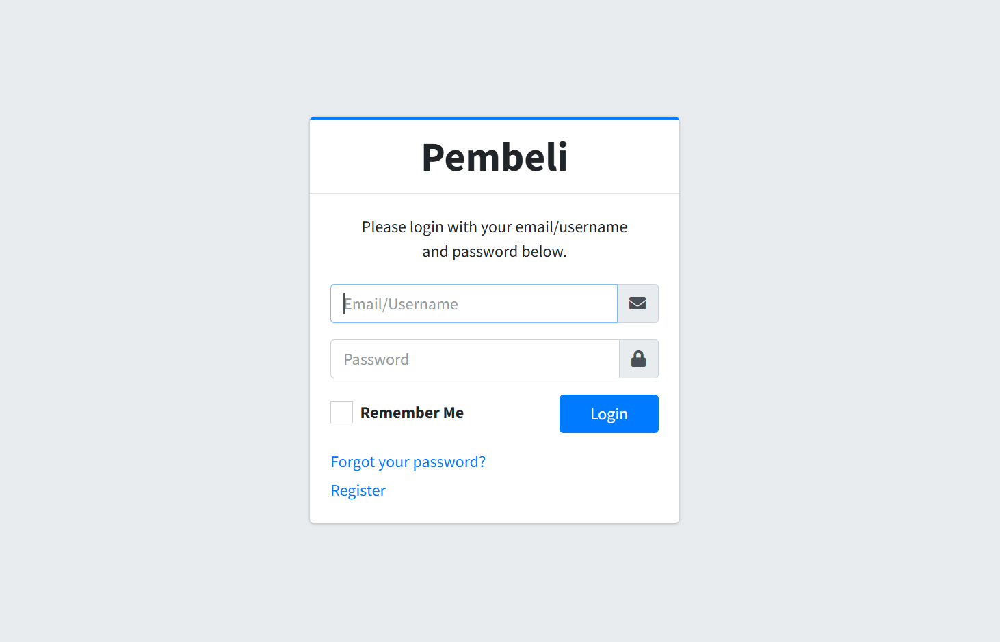
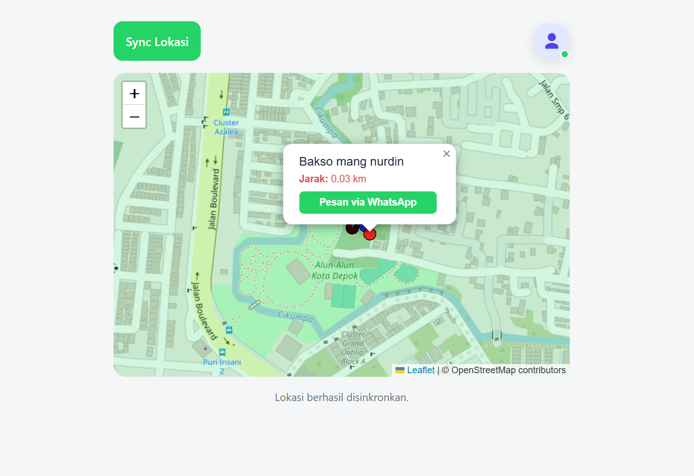
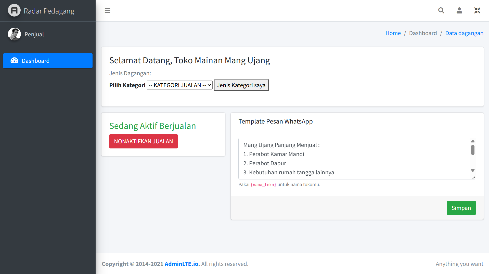
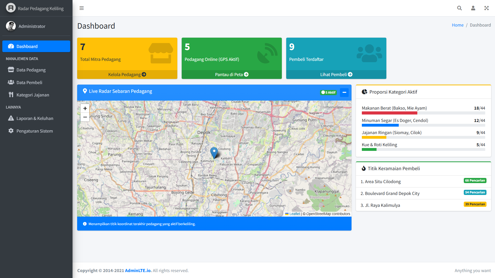
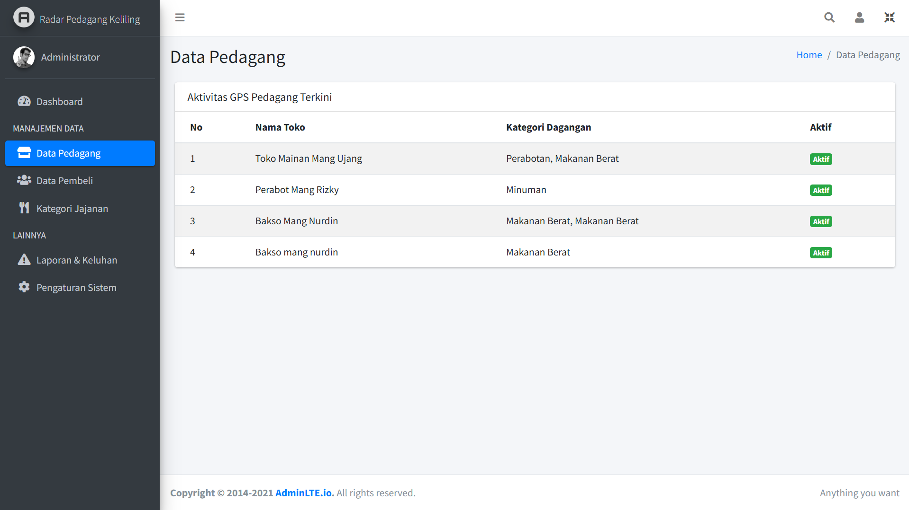
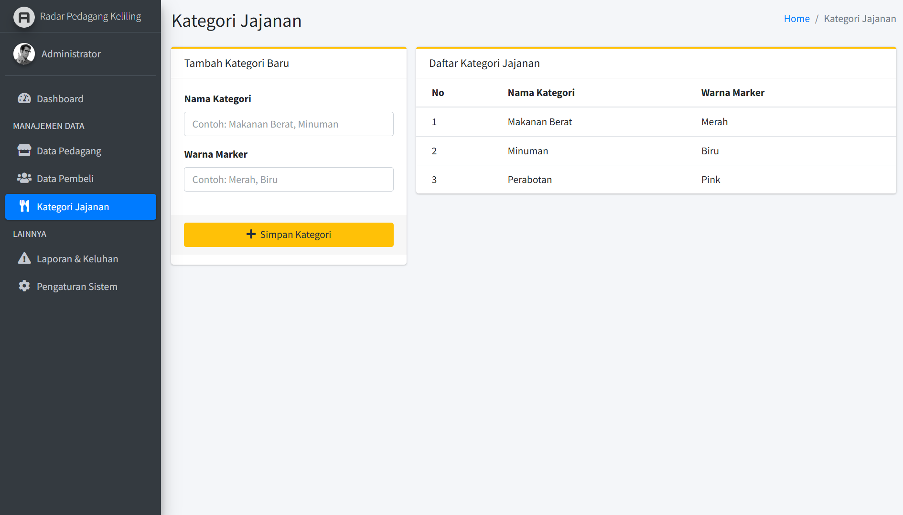

# DARLING (RADAR PEDAGANG KELILING)

**Darling (Radar Pedagang Keliling)** aplikasi berbasis web yang dirancang untuk membantu 
masyarakat menemukan pedagang keliling serta memperoleh informasi mengenai aktivitas usaha mereka. 
Aplikasi ini bertujuan menghubungkan pelanggan dengan pedagang keliling melalui platform digital yang 
memungkinkan pedagang mengelola informasi usaha dan memperbarui status berjualan mereka secara langsung.

Darling berfokus untuk memudahkan pelanggan mengetahui apakah seorang pedagang sedang berjualan atau 
tidak, sekaligus membantu pedagang mengelola aktivitas usahanya melalui dasbor yang sederhana dan 
mudah diakses.

## FITUR-FITUR UTAMA

1. **sinkronisasi lokasi**  
Pembeli dapat menemukan pedagang keliling berdasarkan informasi lokasi dari penjual itu sendiri.

2. **Call to Action ke WhatsApp**  
Pembeli dapat memilih pedagang keliling yang ingin dihubungi melalui WhatsApp.

3. **Registrasi Pedagang**  
Darling menyediakan fitur registrasi yang memungkinkan pedagang keliling membuat akun dan menjadi 
bagian dari aplikasi. Selama proses registrasi, pedagang dapat mengirimkan informasi yang dibutuhkan 
oleh sistem, termasuk detail pribadi dan nomor WhatsApp.

4. **Status Berjualan (Aktif/Tidak Aktif)**  
Memungkinkan pedagang untuk mengaktifkan atau menonaktifkan status berjualan mereka. 

5. **Template Teks Pedagang**  
Pedagang dapat membuat template teks sesuai kemauan.

## USER ROLE & HAK AKSES

### A. Pedagang  
Pengguna utama yang mengelola operasional lapak kelilingnya di dalam sistem. Hal-hal yang dapat 
dilakukan oleh Pedagang meliputi:

1. **Registrasi & Login** : Membuat akun baru dan masuk ke dalam sistem menggunakan kredensial terdaftar.

2. **Mengelola Informasi Usaha** : Memperbarui nama usaha, jenis dagangan, deskripsi, dan nomor 
WhatsApp aktif.

3. **Mengatur Status Berjualan** : Mengaktifkan tombol Mulai Berjualan (active_selling = 1) saat mulai 
berkeliling/berjualan, dan menekan Berhenti Berjualan (active_selling = 0) saat selesai.

4. **Memperbarui Lokasi** : Mengirimkan atau menyesuaikan titik lokasi berjualan saat ini agar muncul pada peta radar pelanggan.

### B. Pelanggan

Pengguna umum yang mencari pedagang keliling di sekitar area mereka. Hal-hal yang dapat dilakukan oleh 
Pelanggan meliputi:

1. **Melihat Peta Radar Pedagang** : Memantau sebaran titik lokasi pedagang keliling yang berstatus aktif dalam radius tertentu secara visual melalui peta.

2. **Melihat Detail Informasi Pedagang** : Mengeklik penanda (marker) pedagang di peta untuk melihat nama usaha, jenis dagangan, dan informasi profilnya.

3. **Menghubungi Pedagang** : Mengakses informasi kontak WhatsApp pedagang untuk menanyakan ketersediaan barang atau memesan secara langsung.

## TECH STACK

| Teknologi | Kategori | Peran / Deskripsi |
| :--- | :--- | :--- |
| **CodeIgniter 3** | *Backend Framework* | Kerangka kerja PHP berbasis arsitektur MVC untuk menangani logika aplikasi dan rute. |
| **MySQL** | *Database* | Sistem manajemen basis data untuk menyimpan informasi akun pedagang, detail usaha, lokasi, dan status `active_selling`. |
| **AdminLTE** | *UI Template* | Templat antarmuka dasbor yang responsif dan terstruktur untuk halaman pengelolaan pedagang. |
| **BootStrap 4.6** | *UI Library* | Template antarmuka standar untuk mempermudah desain tata letak. |
| **Leaflet.js** | *Mapping Library* | Pustaka JavaScript *open-source* untuk menampilkan peta interaktif beserta penanda (*marker*) lokasi pedagang secara langsung. |

## DOKUMENTASI

**Tampilan Login**  

**Tampilan Utama**  

**Dashboard Penjual**  

**Dashboard Admin**  

**Data Pedagang**  

**Kategori**  

